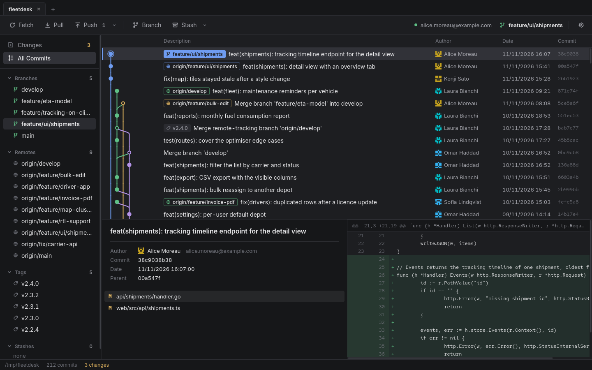
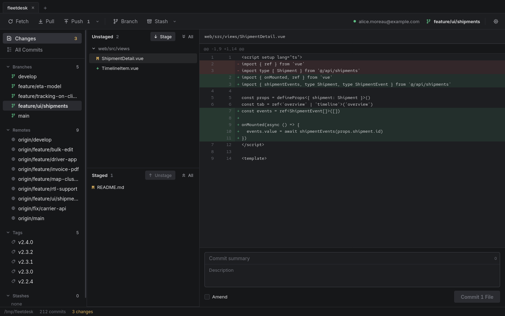

# focagit

A lightweight (~4.5 MB) desktop Git client for Linux, written in Go.

Go · Wails · Vue





## Development

```bash
make test    # go test -race ./...
make dev     # Wails live reload
make build   # desktop binary → build/bin/focagit
make cli     # terminal harness over the git layer
make package # .deb, .rpm and .tar.gz in dist/ (needs nfpm)
```

## Releases

Pushing a `v*` tag builds the Linux packages and attaches them to a GitHub release:

```bash
git tag v0.1.0 && git push origin v0.1.0
```

## Requirements

Go 1.26+, git, Node 20+, and the Wails CLI:

```bash
go install github.com/wailsapp/wails/v2/cmd/wails@v2.13.0
go install github.com/goreleaser/nfpm/v2/cmd/nfpm@v2.48.0   # only for make package
```

`wails doctor` checks the rest.

### Linux

```bash
sudo dnf install gtk3-devel webkit2gtk4.1-devel
```

Fedora 44 ships webkit2gtk 4.1 while Wails v2 defaults to 4.0, so builds need
`-tags webkit2_41`. The Makefile adds it on Linux only.

### macOS

Xcode Command Line Tools (`xcode-select --install`), no build tag. `make build`
produces `build/bin/focagit.app`.

Opening a repository under `~/Documents`, `~/Desktop` or `~/Downloads` raises a
TCC prompt; denying it makes git fail with "operation not permitted".

